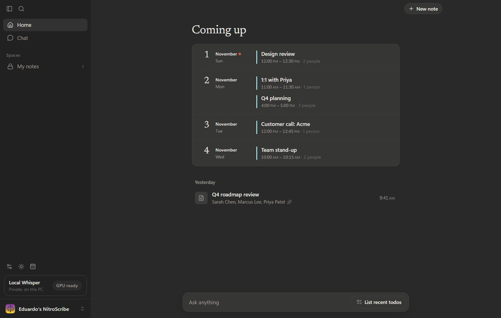
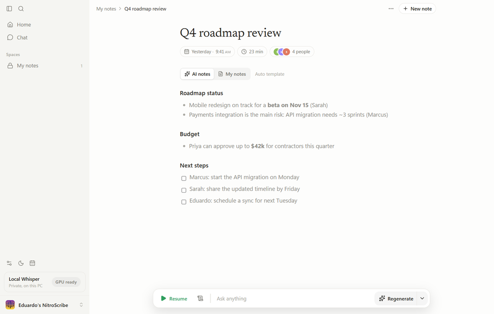
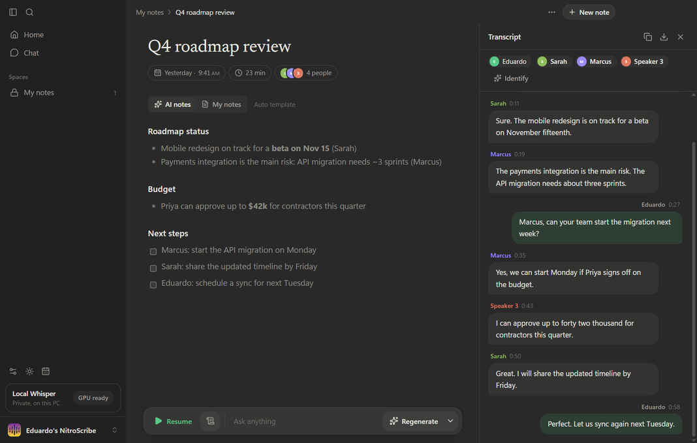
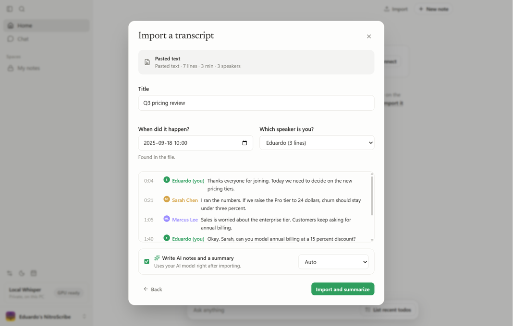

# NitroScribe

**A private AI notepad for your meetings that runs entirely on your own PC.**

NitroScribe transcribes your calls on your own computer, tells the people on the call apart by voice, and turns your rough notes plus the transcript into clean meeting notes. You can also import transcripts from older meetings and get a summary. There are no accounts and no servers, and nothing is uploaded unless you choose to.



## Features

- **Accurate local transcription.** OpenAI's Whisper Large v3 runs on your NVIDIA GPU (or CPU) through [whisper.cpp](https://github.com/ggml-org/whisper.cpp). It handles 99 languages with auto-detection and works offline.
- **Both sides of the call.** It records your microphone plus your computer's audio, so it works with Zoom, Teams, Meet, Slack huddles and anything else. No bot joins the meeting.
- **Speakers by name.** Everyone on the call is told apart by voice. Names come from what people say ("thanks, Sarah"), from your calendar, or from you clicking a speaker and typing their name. People you name are recognized automatically in later meetings.
- **AI notes.** Jot rough notes during the call. Afterwards NitroScribe expands them with the details from the transcript: your words stay black and AI additions are gray. Templates cover summaries, 1:1s, stand-ups, sales calls, interviews and more, and you can write your own.
- **Import old meetings.** Drop in a transcript from Zoom, Teams, Google Meet or Otter, or paste one. You can also drop in a recording (mp3, m4a, wav, ogg, flac or a video) to have it transcribed, with speakers separated, on your computer. Set its date and get a summary. Any meeting's date can be changed later by clicking it.
- **Action items across all your meetings.** Each comes with its owner and a real deadline: "by Friday" becomes the actual date, counted from when the meeting happened. Check them off, add one to Google Calendar in a click, or export every deadline as a calendar file for Google, Outlook or Apple Calendar.
- **Ask anything** about one meeting or your whole history ("what did we decide about pricing last month?").
- **Your choice of AI.** Local models through Ollama or LM Studio by default. Cloud providers (OpenAI, Anthropic, Gemini, OpenRouter, Groq, Mistral, DeepSeek, xAI or any OpenAI-compatible API) are opt-in.
- **Unlimited history on your disk.** Meetings are plain files that you can search (Ctrl+K), export to Markdown, or download as TXT/SRT/JSON transcripts.
- Calendar via a private iCal link (Google / Outlook) with reminders when meetings start, light and dark themes, and a tray icon.

| Notes | Speakers | Import |
| --- | --- | --- |
|  |  |  |

## Privacy and security

NitroScribe was built so your meetings never leave your computer:

- **Audio** is transcribed in memory on your PC. It is never saved to disk and never sent anywhere.
- **Local-only mode (on by default)** means meeting text can only go to AI models on your PC or home network (Ollama, LM Studio). To use a cloud model you have to switch it off on purpose, and the app tells you exactly what that sends.
- **The app window cannot reach the internet.** Every request from the interface is blocked. AI requests, calendar sync and model downloads run only in the app's background process, and that's where Local-only mode blocks cloud AI.
- **Calendar sync** only downloads the iCal links you add; nothing is uploaded.
- **No telemetry**: no accounts, analytics, crash reporting or auto-updates.
- **Verified downloads.** The speech engine and models are downloaded once during setup and checked against pinned SHA-256 fingerprints.
- **Your data stays readable and yours.** Meetings are plain JSON files in `%APPDATA%\NitroScribe`; turn on Windows device encryption/BitLocker to protect the disk. API keys, if you add any, are encrypted with your Windows account.
- **Hardened desktop shell.** The interface is sandboxed with context isolation and a strict content security policy. The installed app checks its own files for tampering and can't be repurposed to run other code. The camera is never allowed. Windows only exposes computer audio through screen capture, so NitroScribe requests it and discards the picture immediately.

Settings → **Privacy & data** lists everything that touches the network, live.

> Please make sure the people you meet with are OK with being transcribed. Recording laws differ by country and state.

## Install

1. Download `NitroScribe-Setup-x.y.z.exe` from [Releases](../../releases). Check its fingerprint against `SHA256SUMS.txt` if you like.
2. Run it. The installer isn't code-signed, so Windows SmartScreen may ask you to confirm ("More info" → "Run anyway").
3. On first launch NitroScribe downloads the speech engine and models (about 1.8 GB).
4. For AI notes, install [Ollama](https://ollama.com), pull a model (for example `ollama pull llama3.2:3b` on a 4 GB GPU, or `qwen2.5:7b` for better notes), then choose it in Settings → AI model.

**Requirements:** Windows 10/11 (64-bit), about 3 GB of disk space, and 8 GB+ of RAM. An NVIDIA GPU with 4 GB+ VRAM is recommended; it also runs on the CPU, just more slowly.

### Mac (Apple Silicon)

1. Download `NitroScribe-x.y.z-mac-arm64.dmg` from [Releases](../../releases), open it, and drag NitroScribe into Applications.
2. The app isn't notarized by Apple, so the first time you open it, go to **System Settings → Privacy & Security** and click **Open Anyway**.
3. Allow the **Microphone** prompt. Also allow **Screen & System Audio Recording** if you want the other side of the call transcribed: macOS only shares computer audio that way, and NitroScribe never keeps the picture.

Transcription runs on the Mac's GPU (Metal), and the models download on first launch (about 1.1 GB). Requires macOS 13 or later on an M-series Mac. If macOS won't share the call's audio, NitroScribe transcribes your microphone only and says so.

## Using it

1. Click **New note** (Ctrl+N) when a call starts. NitroScribe starts transcribing.
2. Write notes if you want. The green bars at the bottom show it's listening; click them to see the live transcript.
3. Click **Stop** when the call ends. NitroScribe finishes the transcript, works out who's who, and writes your notes.
4. Click a speaker's name in the transcript to rename them. NitroScribe remembers their voice for next time.

**Importing:** click **Import** at the top or drop a file anywhere in the window. Supported formats:

| Format | Files |
| --- | --- |
| Zoom, Teams and Google Meet captions | `.vtt` |
| Subtitles | `.srt` |
| Teams transcript downloads | `.docx` |
| Otter, Meet and other text exports | `.txt` |
| Markdown | `.md` |
| NitroScribe exports | `.json` |
| Pasted text | `Name: what they said` lines, with or without timestamps |

## Build from source

```bash
git clone <this repo>
cd nitroscribe
npm ci
npm run dev      # run with hot reload
npm test         # unit tests
npm run dist     # build the installer into dist/
```

See [AGENTS.md](AGENTS.md) for architecture notes and the integration and end-to-end test setup.

## Credits

NitroScribe stands on great open-source work:

| Component | Used for | License |
| --- | --- | --- |
| [whisper.cpp](https://github.com/ggml-org/whisper.cpp) | Speech engine | MIT |
| [OpenAI Whisper](https://github.com/openai/whisper) | Models | MIT |
| [sherpa-onnx](https://github.com/k2-fsa/sherpa-onnx) | Voice recognition runtime | Apache-2.0 |
| [3D-Speaker CAM++](https://github.com/modelscope/3D-Speaker) | Voice model | Apache-2.0 |
| [Electron](https://www.electronjs.org), [React](https://react.dev), [Tiptap](https://tiptap.dev), [Tailwind CSS](https://tailwindcss.com), [Lucide](https://lucide.dev) | App | MIT / ISC |
| [Newsreader](https://github.com/productiontype/Newsreader) | Font | OFL |
| [LibriSpeech](https://www.openslr.org/12) | Test audio clips | CC BY 4.0 |

## License

[MIT](LICENSE)
